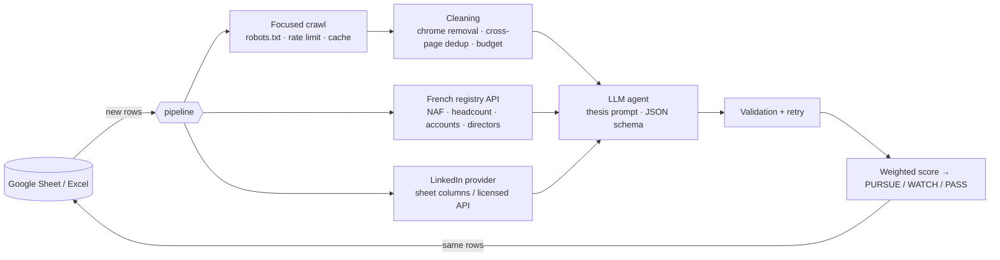

# pe-origination-agents

[](https://github.com/Lucas-Medina-Dev/pe-origination-agents/actions/workflows/ci.yml)


**An LLM agent that screens buy-and-build acquisition targets.** Give it a list of companies in a Google Sheet or Excel file. For each one it reads the website, pulls the official registry record and any LinkedIn data, scores the company against your investment thesis, and writes a decision back into the same sheet: **PURSUE / WATCH / PASS**, with a score, a rationale and quoted evidence.

Console output format (illustrative company names and scores):

```
$ pe-origination run examples/config.yaml
Thesis: HVAC & multi-technical maintenance roll-up — Western France · model openai/gpt-5
  PURSUE   81.8  <company A>
  WATCH    56.4  <company B>
  PASS     27.3  <company C>
  ✗ <company D>                              no evidence found (website unreachable, …)
```

## Origin

This is a Python rebuild of **Dealflow.ai**, an origination tool I co-built in n8n that was used by a European mid-market PE fund. The n8n version did the job, but crudely: it scraped whole pages as raw text (menus, cookie banners and footers included), relied on LinkedIn scraping, and asked the model for a free-text answer. This version keeps the idea and fixes each of those weaknesses:

| | n8n version | This repository |
|---|---|---|
| Website | Every page, raw text | Home page + the 5 most relevant pages, chrome removed, template lines de-duplicated across pages |
| Company facts | Scraped LinkedIn | Official French registry (headcount, revenue, age, status, director ages) + LinkedIn data **via a provider interface, no scraping** |
| Model output | Free text in a cell | Validated JSON: one score per thesis criterion, verbatim evidence, red flags, data gaps |
| Decision | Asked of the model | **Computed in code** from weighted criterion scores, so it is reproducible and auditable |
| Robustness | One failure stopped the flow | Per-company error capture, retries, resumable runs, cache |

## How it works



### What the agent actually sees

The output of `pe-origination evidence config.yaml "<company>"` on the test fixture (a fictional HVAC company with menus, a cookie banner and footers in its HTML):

```
== registry ==
Legal name: THERMO SERVICES OUEST (SIREN 123456789)
Status: active
Activity code (NAF): 43.22B
Employees (registry bracket): 20–49
Published accounts 2024: revenue €6.8m, net income €520,000
Oldest individual director: ~68 years old — succession signal

== website (3 pages, 832 chars) ==
### Thermo Services Ouest — Maintenance CVC
# Votre partenaire CVC depuis 1987
Thermo Services Ouest assure la maintenance multi-technique de plus de 400 sites tertiaires et industriels.
Contrats de maintenance pluriannuels, astreinte 24/7 et interventions sous 4 heures.

### Qui sommes-nous
## Une entreprise familiale
Fondée en 1987 par Jean Martin, l'entreprise compte 45 techniciens répartis sur 3 agences : Nantes, Rennes et Angers.

### Nos prestations
- Chaufferies et pompes à chaleur
- Contrats P2 / P3
```

Cookie banner, navigation, newsletter box, phone number repeated on every page, copyright footer: all gone.

### Scoring

The thesis defines weighted criteria (default: `sector_fit 3`, `size_fit 2`, `business_quality 2`, `add_on_potential 2`, `geography_fit 1`, `succession_signal 1`). The model scores each criterion from 0 to 10. When evidence is missing it must score 5, explain why, and list the gap. The code then computes:

```
fit score = Σ (weight × criterion score) / Σ weight × 10        → 0–100
PURSUE ≥ 70 > WATCH ≥ 45 > PASS        (thresholds in the thesis)
```

Two rules override the score: a thesis exclusion flagged by the model, and a company registered as ceased, both force **PASS**.

### Results written to the sheet

`AI fit score` · `AI recommendation` · `AI summary` · `AI add-on rationale` · `AI criteria` (e.g. `sector_fit 9/10 | size_fit 7/10 …`) · `AI red flags` · `AI evidence` (quotes + URLs) · `AI confidence` · `AI assessed at` · `AI status`

Input columns are never modified. Rows already scored are skipped on the next run (`--force` re-scores them). Failed rows get `error: …` in `AI status` and are retried next time.

## Quick start

```bash
git clone https://github.com/Lucas-Medina-Dev/pe-origination-agents.git
cd pe-origination-agents
pip install -e ".[openai]"          # or ".[anthropic]"; add ",sheets" for Google Sheets
export OPENAI_API_KEY=...

# 1. put your targets in examples/targets.xlsx (Company, Website, LinkedIn, optional SIREN)
# 2. adapt the thesis in examples/config.yaml
pe-origination evidence examples/config.yaml "Company name"   # check what the agent will read
pe-origination run examples/config.yaml --limit 5             # score the first five
```

**Google Sheets:** set `sheet.type: google`, `spreadsheet_id`, and a service-account JSON shared on the sheet. Writes are batched into one API call per save.

### The thesis lives in config, not in code

```yaml
thesis:
  name: HVAC & multi-technical maintenance roll-up — Western France
  sectors: [HVAC maintenance, Multi-technical building maintenance]
  size: {min_employees: 20, max_employees: 150, min_revenue_eur: 3000000}
  must_have: [Recurring maintenance contracts (P2/P3), B2B / public clients]
  exclusions: [Residential-only business, Subsidiary of a large listed group]
  succession_age: 60
  weights: {sector_fit: 3, size_fit: 2, business_quality: 2, add_on_potential: 2,
            geography_fit: 1, succession_signal: 1}
```

To screen for a new mandate (say, dental labs in Italy instead of HVAC in France), change this block. Criteria are free-form: add `recurring_revenue: 3` and the model scores it.

## Design notes

- **Polite crawling.** The crawler respects robots.txt, waits between requests to the same host (thread-safe), retries 429/5xx with backoff, accepts HTML only, caps page size and caches pages on disk.
- **Focused crawling.** Links are ranked with French and English keywords (`qui-sommes-nous`, `prestations`, `références`, `about`, `services`…). Legal, login, careers and file links are excluded.
- **Budgeted digest.** The text budget is shared fairly across pages, and unused budget from short pages flows to long ones, so one bloated page cannot crowd out the rest.
- **Prompt-injection guard.** Scraped text is fenced in `<website>`, `<registry>` and `<linkedin>` tags, and the system prompt states that nothing inside them is an instruction.
- **Validation with feedback.** If the model's JSON is invalid or misses a criterion, the error is sent back once before the row is marked as failed.
- **Registry name matching.** A SIREN gives an exact match. Otherwise the best of the top 5 results is kept only above a similarity threshold, and weak matches are flagged in the evidence.
- **No LinkedIn scraping.** It breaches LinkedIn's User Agreement. LinkedIn data comes from sheet columns (manual entry or a licensed export) or from your own `LinkedInProvider` implementation.

## Tests

```bash
pip install -e ".[dev]"
pytest        # 33 tests, no network: HTTP mocked with respx, model replaced by a fake client
ruff check src tests
```

The tests cover chrome removal and cross-page de-duplication, robots.txt compliance, retries and caching, link ranking, registry parsing and the succession signal, name-match rejection, prompt fencing, weighted scoring, recommendation bands, exclusion and ceased-company overrides, the retry-on-invalid-JSON loop, and an end-to-end run on an Excel file (write-back, untouched input columns, skip-on-rerun, error rows).

## Layout

```
src/pe_origination/
  config.py            run config + investment thesis (pydantic)
  fetch.py             polite HTTP fetcher
  clean.py             HTML → clean text, cross-page dedup, budgeted digest
  sources/website.py   focused crawler
  sources/registry.py  French registry (recherche-entreprises.api.gouv.fr)
  sources/linkedin.py  provider interface
  sources/sheets.py    Excel and Google Sheets backends
  agent/               prompt, schema, model clients, validation and scoring
  pipeline.py          concurrent run with per-row error handling
  cli.py               `run` and `evidence` commands
examples/              config.yaml (HVAC roll-up thesis), targets.xlsx template
```

## Limitations

- The registry source covers French companies. Other countries need another `RegistryProvider` (e.g. Companies House for the UK).
- Websites rendered entirely in JavaScript return little text. A headless-browser fetcher could be plugged into `Fetcher`.
- The agent screens; it does not decide. Its output is a ranked shortlist for an analyst to verify.

---

MIT © 2026 Lucas Medina
